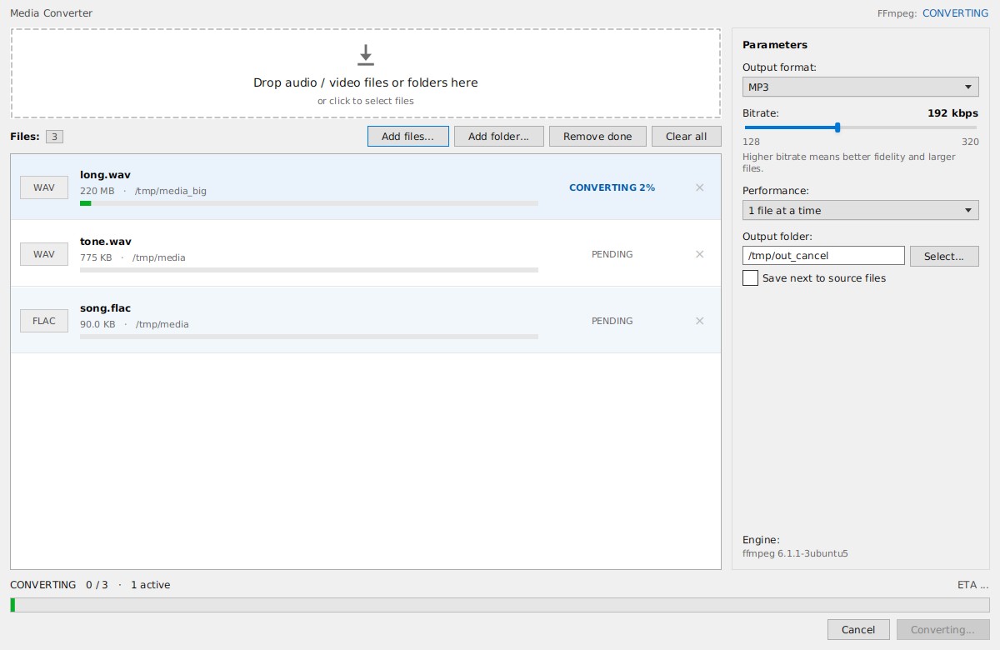

# Media Converter

A small desktop app that converts any audio or video file to **MP3, WAV, FLAC, AAC (M4A) or OGG Vorbis**.
It is a JavaFX front end around [FFmpeg](https://ffmpeg.org/): drop files in, pick a format, press **Convert**.



## Features

- **Any input FFmpeg can read** — MP4, MKV, AVI, MOV, WAV, FLAC, AC3, OGG and many more. The audio track is extracted; video is dropped.
- **Output formats:** MP3 (libmp3lame), AAC in M4A, OGG Vorbis, WAV (PCM 16-bit), FLAC.
- **Bitrate selector** for lossy formats: 128 / 160 / 192 / 224 / 256 / 320 kbps (disabled for WAV and FLAC).
- **Batch processing** — drop hundreds of files or whole folders (scanned recursively). Each row shows its own status: Pending, Converting (X%), Completed, Failed or Cancelled.
- **Real progress** parsed line by line from FFmpeg's `-progress` output, plus an overall progress bar and ETA.
- **Parallel conversion** — 1 to 8 files at a time on a bounded thread pool; the UI never blocks.
- **Cancel** at any time: running FFmpeg processes are stopped and partially written files are deleted.
- **Safe output names** — existing files are never overwritten; you get `song.mp3`, `song (1).mp3`, `song (2).mp3`, …
- **Output folder** of your choice, or "save next to source files".
- **Opens the output folder automatically** (via `java.awt.Desktop`) when a batch finishes successfully.
- **FFmpeg check on startup** with a dialog that shows an install command for your OS if FFmpeg is missing.
- Light, classic Windows-utility look (gray window, white fields, standard buttons).

## Requirements

| Requirement | Version |
|-------------|---------|
| JDK         | 17 or newer |
| Maven       | 3.8+ (only to build) |
| FFmpeg      | any recent build, available on the system `PATH` |

Install FFmpeg if you don't have it yet:

```bash
# Windows
winget install Gyan.FFmpeg
# macOS
brew install ffmpeg
# Debian / Ubuntu
sudo apt install ffmpeg
```

Check with `ffmpeg -version`. MP3 and OGG output need an FFmpeg build with `libmp3lame` and `libvorbis` (standard builds include both).

## Build and run

Run from source:

```bash
mvn clean javafx:run
```

Build a single runnable jar:

```bash
mvn clean package
java -jar target/neon-sonic-1.0.0-shaded.jar
```

> The shaded jar bundles the JavaFX natives of the operating system it was built on.
> Build on each platform you want to support.

## Usage

1. Drag audio/video files or folders onto the window (or click the drop area / **Add files…** / **Add folder…**).
2. Choose the **output format**, **bitrate**, number of **parallel files** and the **output folder**.
3. Press **Convert**. Use **Cancel** to stop the batch.
4. When everything is done, the output folder opens in your file manager.

Failed files keep their row; hover the status to see FFmpeg's error message. Press **Convert** again to retry failed or cancelled files.

## How it works

For every file the engine runs roughly:

```
ffmpeg -hide_banner -nostdin -y -i <input> -vn -map 0:a:0? -map_metadata 0 \
       -c:a <codec> [-b:a <N>k] -progress pipe:1 -nostats <output>
```

- Only the **first audio stream** is converted; tags are copied.
- MP3 output is downmixed to **stereo** (libmp3lame does not support 5.1).
- Progress = `out_time_us` / the `Duration:` printed by FFmpeg. If the duration is unknown, the row shows an indeterminate bar.

## Project structure

```
src/main/java/com/neonconv/
├── App.java              JavaFX application entry point
├── Launcher.java         main class for the shaded jar
├── MainController.java   FXML controller: drag & drop, bindings, dialogs
├── MainViewModel.java    queue, settings and commands (no UI controls)
├── ConverterEngine.java  thread pool, FFmpeg ProcessBuilder, progress parsing
├── MediaItem.java        one queue row (observable model)
├── QueueCell.java        list-row renderer
├── NeonDialog.java       modal message dialog
├── NeonFx.java           animation helpers (currently unused by the classic theme)
└── WaveVisualizer.java   equalizer widget (hidden in the classic theme)
src/main/resources/com/neonconv/
├── main.fxml             window layout
└── style.css             light classic theme
```

Architecture: **MVVM**. `ConverterEngine` knows nothing about the UI. It creates one JavaFX `Task` per file on a `ThreadPoolExecutor`, and a `ScheduledService` polls those tasks a few times per second to publish aggregated stats (overall progress, ETA). `MainViewModel` exposes the state, and `MainController` only binds it to the FXML nodes.

## Customising the look

All colours and shapes live in `style.css`. The stylesheet uses literal colours so that popups and dialogs match the main window.

## Known limitations

- Only the first audio track of a file is converted.
- Output folder opening depends on the OS file manager being available to `java.awt.Desktop`.
- The app talks to the `ffmpeg` executable found on `PATH`; a custom FFmpeg location is not configurable yet.

## License

Add a license of your choice (for example MIT) as `LICENSE` before publishing.
FFmpeg is a separate project under its own licence and is **not** distributed with this application.
